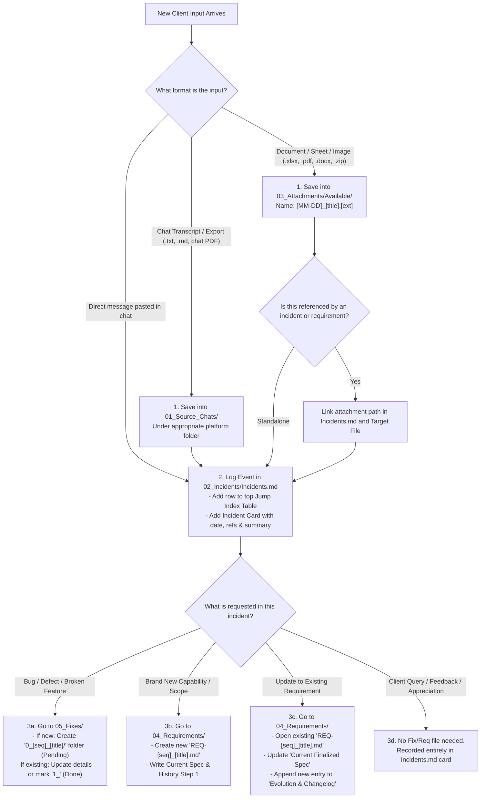

# {{PROJECT_NAME}} — Knowledge Base & Project Intelligence System

Welcome to the centralized, streamlined knowledge management repository for **{{PROJECT_NAME}}** (`{{PROJECT_DOMAIN}}`).

This repository is engineered to eliminate noise, guarantee 100% traceability to verified client communications, and provide instant navigation for human developers, project managers, and AI coding agents.

---

## 1. High-Level Architecture & Core Pillars

```text
knowledge_base/
├── start.md                          <- Onboarding guide & template placeholder checklist
├── README.md                          <- [This File] Master Architecture, Triage & Agent Operating Guide
│
├── 00_Utilities/                      <- Pillar 0: Codebase paths, environments & server SSH access
│   ├── Repository locations.md        <- Paths to all local code repositories
│   ├── Server access.md               <- SSH commands & server connection strings
│   └── README.md                      <- Operational guidelines & security rules
│
├── 01_Source_Chats/                   <- Pillar 1: Permanent archive of all raw client chat exports
│   ├── WhatsApp/                      <- WhatsApp exports (.txt, .md)
│   ├── Slack/                         <- Slack channel exports
│   ├── Email/                         <- Direct email correspondence
│   ├── Upwork_Fiverr_Other/           <- Platform communication archives
│   └── README.md                      <- Chat archive rules & naming guide
│
├── 02_Incidents/                      <- Pillar 2: Master Chronological Knowledge Base & Event Timeline
│   ├── Incidents.md                   <- Single Master File: Quick Jump Index Table + Incident Cards
│   └── README.md                      <- Instructions on how to log new incidents
│
├── 03_Attachments/                    <- Pillar 3: All client-supplied documents & assets
│   ├── Available/                     <- Verified files (.xlsx, .pdf, .docx, images, UI packs)
│   ├── Missing/                       <- missing_files.md tracking files referenced but not yet received
│   └── README.md                      <- Attachment naming conventions & ingestion rules
│
├── 04_Requirements/                   <- Pillar 4: Living feature specifications with internal version logs
│   ├── REQ-00_template_feature_specification.md <- Starter specification template
│   └── README.md                      <- One-file-per-requirement standard & instructions
│
└── 05_Fixes/                          <- Pillar 5: Actionable bug fixes with instant status visibility
    ├── 0_00_template_issue/           <- Standard 5-file fix issue folder template
    └── README.md                      <- 0_ vs 1_ prefix lifecycle & reproduction standards
```

---

## 2. Master Decision Tree & Ingestion Workflow

When new input arrives (a new chat export, client attachment, or direct instruction), follow this step-by-step triage workflow:



---

## 3. How to Handle Inputs in Each Section

### A. How to determine whether an input is a Chat or an Attachment
- **Chat (`01_Source_Chats/`):** A conversational dialogue between two or more people with timestamps and senders (e.g. WhatsApp export, Slack transcript, email thread). These are immutable source records.
- **Attachment (`03_Attachments/Available/`):** A document, spreadsheet, PDF brief, UI screenshot, or asset package sent by the client to support their instructions.
- **Missing Attachment (`03_Attachments/Missing/missing_files.md`):** If a client mentions a file in chat (e.g. *"Please review the sheet I sent"*), but the file is not yet available, log it immediately in `missing_files.md`.

### B. How to handle `02_Incidents/Incidents.md`
- **Google Docs-style Jump Navigation:**
  - The top of `Incidents.md` contains the master index table. Every title is a markdown anchor link:
    ```markdown
    | [01](#incident-01-short-title) | YYYY-MM-DD HH:MM | Short Title | Fix | [Chat Ref] | [Attach Ref] | [Target File] |
    ```
  - Clicking `[01]` instantly jumps the reader or AI agent directly to `### Incident 01: ...` below.
- **Incident Cards:**
  - Each card records: Date-Time, Sender, Medium, Chat Reference, Attachment Reference, Type, Summary, Action Checklist, and Target Record link.

### C. How to handle `04_Requirements/`
- **The Rule of Single Living Files:** **Never** create duplicate files like `REQ-01_update.md` or `REQ-01_v2.md`.
- **Top of the file:** Houses the `Current Finalized Specification (Source of Truth)`. Anyone wanting to know "What should we build right now?" reads lines 1–25.
- **Bottom of the file:** Houses the `Requirement Evolution & History Log`. Every time a client amends a requirement:
  1. Update the top specification to match the new agreement.
  2. Append an `### Update [X]: [Date]` block below detailing what changed, why, and citing the source incident.

### D. How to handle `05_Fixes/`
- **Folder Architecture (Standard for Fixes):**
  - Every fix issue has its own dedicated subfolder:
    ```text
    05_Fixes/
    └── [STATUS]_[SERIAL]_[title_snake_case]/
        ├── README.md                      <- Issue dashboard & navigator
        ├── Problem_Statement.md           <- User/client communication, defect summary, observed vs. expected
        ├── Problem_Investigation.md       <- Server DB queries, logs, root cause analysis
        ├── Proposed_Solutions.md          <- Evaluated architecture options & trade-offs
        └── Implementation_Plan.md         <- Step-by-step code/DB changes & verification checklist
    ```
- **Prefix Standard:**
  - `0_` prefix = **Pending / Open** (e.g., `0_01_payment_failure/`).
  - `1_` prefix = **Done / Resolved** (e.g., `1_01_payment_failure/`).
- **Resolving a Fix:**
  1. Resolve the defect in code/database.
  2. Open the issue folder's `README.md`, update status to `Status: Done`, and document the resolution under `Implementation_Plan.md`.
  3. Rename the issue folder: change leading `0_` to `1_`.
  4. Update status in `02_Incidents/Incidents.md`.

---

## 4. Agent Operating Prompt (For AI Coding Assistants)

When instructing an AI agent to ingest new client data or maintain this repository, provide it with the following prompt:

> ### 🤖 AI Agent System Prompt
> You are the Knowledge Base Manager for {{PROJECT_NAME}}.
> 
> When new client communication or files arrive, you must:
> 1. **Triage Input:**
>    - If it is a conversation transcript, save it in `01_Source_Chats/`.
>    - If it is a document/spreadsheet/asset, save it in `03_Attachments/Available/` using `[MM-DD]_[title].[ext]`.
>    - If a referenced file is missing, record it in `03_Attachments/Missing/missing_files.md`.
> 2. **Record Incident:**
>    - Open `02_Incidents/Incidents.md`.
>    - Add the next sequential incident row to the top jump index table.
>    - Add the corresponding Incident Card below with exact timestamp, sender, medium, chat/attachment links, summary, and action items.
> 3. **Dispatch Actions:**
>    - **For Bug Fixes:** Check `05_Fixes/`. If new, scaffold `0_[seq]_[title]/` with the 5 standard files. If resolved, verify tests, rename prefix to `1_`, and update incident links.
>    - **For New Requirements:** Create `04_Requirements/REQ-[seq]_[title].md` with the current spec and Initial Requirement in the changelog.
>    - **For Requirement Updates:** Find the existing `REQ-[seq]_[title].md` in `04_Requirements/`. Update the top `Current Finalized Specification`, and append a new update step to the `Evolution & History Log`. **Never create a new file for an updated requirement.**
> 4. **Preserve Integrity:** Never invent facts, never delete historical evolution logs, and ensure all markdown links are relative and functional.
> 5. **Language & Communication:** Use easy words and phrases so that the message can be easily conveyed to the readers. Explain things in such a way that anyone can easily understand what is going on.
> 6. **Technical Explanations:** Explain the architecture, flow, issues, and logic clearly in plain English so that any developer on the team can immediately understand.
