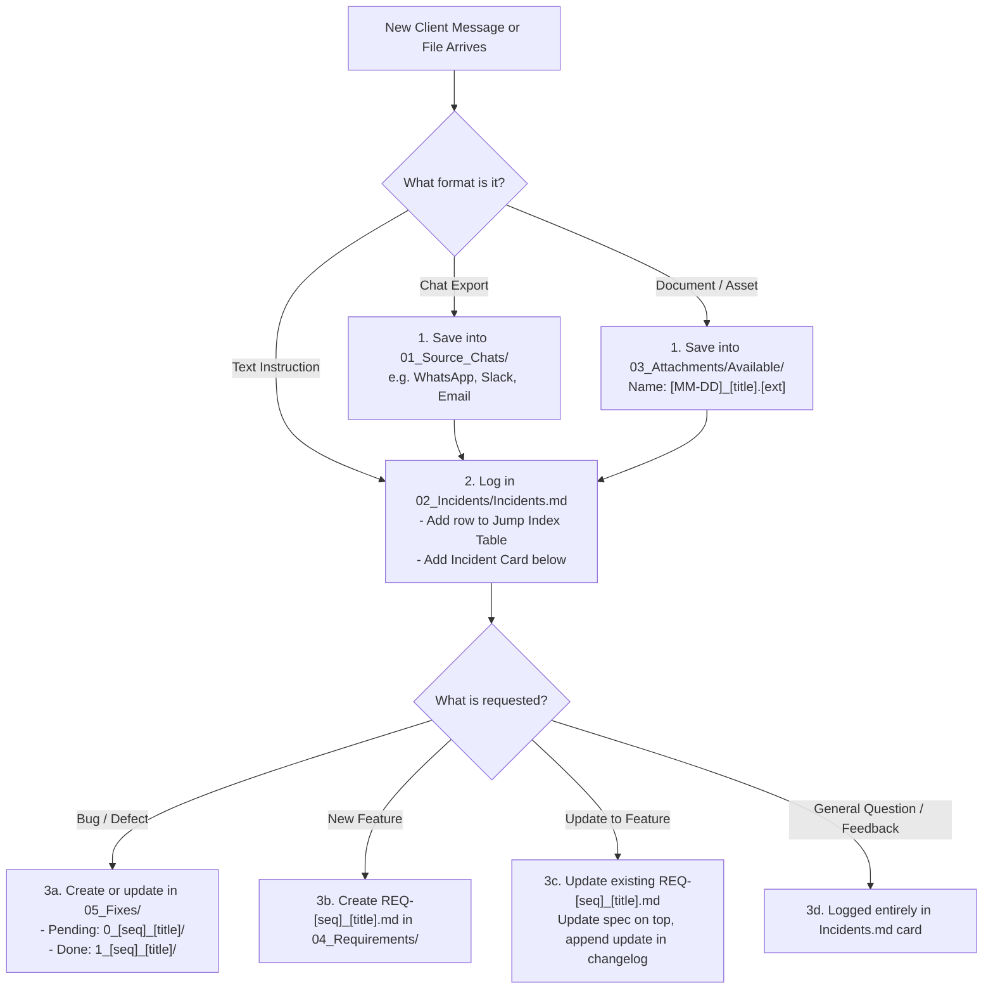

# Project Knowledge Base Starter Template — Onboarding Guide (`start.md`)

Welcome to the **Client Chat & Project Knowledge Base Starter Template**!

This template provides a standardized, high-discipline Knowledge Base and Project Intelligence System for software projects. It is designed to eliminate information loss, preserve raw client communications, ensure complete traceability between requests and code, and provide clear navigation for developers, PMs, and AI coding agents (such as Antigravity, Cursor, and Claude).

---

## 1. Quick Setup: Starting a New Project

Follow these 5 steps whenever you start working on a new project:

### Step 1: Copy the Template
Copy the entire `client_chat_knowledge_agent_starter` folder into your project workspace. Typically, you will rename it to `knowledge_base/` inside your project directory:

```text
my-new-project/
├── backend/                  <- Your backend code repository
├── frontend/                 <- Your frontend code repository
└── knowledge_base/           <- [Pasted from this template]
    ├── start.md
    ├── README.md
    ├── 00_Utilities/
    ├── 01_Source_Chats/
    ├── 02_Incidents/
    ├── 03_Attachments/
    ├── 04_Requirements/
    └── 05_Fixes/
```

---

### Step 2: Global Search & Replace Placeholders
Use your code editor's global Find & Replace feature across the `knowledge_base` folder to replace the placeholder tags with your project's specific details:

| Placeholder Keyword | What to Replace With | Example Replacement |
|---|---|---|
| `{{PROJECT_NAME}}` | Official name of your project or application | `Acme Commerce` |
| `{{PROJECT_DOMAIN}}` | Primary website URL or application domain | `www.acme-shop.com` |
| `{{CLIENT_NAME}}` | Name of the client, stakeholder, or product owner | `Sarah Jenkins / Acme Corp` |
| `{{CLIENT_CONTACT}}` | Primary client communication channel / group | `WhatsApp Group: Acme Dev Team` |
| `{{BACKEND_REPO_PATH}}` | Local file system path to the backend code | `C:\Projects\acme\code\backend` |
| `{{FRONTEND_REPO_PATH}}` | Local file system path to the frontend code | `C:\Projects\acme\code\frontend` |
| `{{MOBILE_REPO_PATH}}` | Local path to mobile app code (or delete section) | `C:\Projects\acme\code\mobile` |
| `{{SERVER_IP_MAIN}}` | IP or hostname of the primary production server | `18.200.45.10` |
| `{{SERVER_IP_TEST}}` | IP or hostname of the staging / testing server | `54.120.90.15` |
| `{{SSH_KEY_NAME}}` | Filename of the SSH private key / PEM file | `acme_prod_key.pem` |

---

### Step 3: Configure `00_Utilities/`
Open `00_Utilities/` and fill in the initial operational settings:
1. **`Repository locations.md`**: Confirm the local paths to each repository on your development machine.
2. **`Server access.md`**: Update SSH commands, server usernames, and IP addresses.
   > **SECURITY MANDATE:** Never paste or commit private `.pem` keys or passwords into this knowledge base. Only reference the file path to the key.

---

### Step 4: Archive Initial Client Communication
1. **Chat Exports:** Save initial chat exports, briefs, or conversation history into `01_Source_Chats/` under the appropriate channel folder (`WhatsApp/`, `Slack/`, `Email/`, etc.).
2. **Client Files:** Save any initial attachments, sheets, PDFs, or design packs into `03_Attachments/Available/` following the naming rule: `[MM-DD]_[title].[ext]`.
3. **Log Incident 01:** Open `02_Incidents/Incidents.md`:
   - Add row `#1` to the top master index table.
   - Fill in the initial Incident Card with the kickoff date, sender, chat reference, summary, and action items.

---

### Step 5: Onboard AI Coding Agents
When using AI coding assistants (such as Antigravity, Cursor, Copilot, or Claude Code):
1. Point the AI agent to `knowledge_base/README.md`.
2. The agent will read **Section 4: Agent Operating Prompt** and automatically understand:
   - How to triage incoming client messages.
   - The 5-pillar directory layout.
   - How to track bugs in `05_Fixes/` (using `0_` for pending, `1_` for resolved).
   - How to update living specifications in `04_Requirements/`.
   - The communication rule: write in easy, plain English so all team members can understand the issues and architectural decisions.

---

## 2. Directory Structure Overview

```text
knowledge_base/
├── start.md                          <- [This File] Setup & replacement guide
├── README.md                          <- Master Architecture, Triage Flowchart & Agent System Prompt
│
├── 00_Utilities/                      <- Pillar 0: Repository paths & server SSH access
│   ├── README.md                      <- Instructions & security rules
│   ├── Repository locations.md        <- Local codebase paths
│   └── Server access.md               <- Server IP addresses & SSH connection strings
│
├── 01_Source_Chats/                   <- Pillar 1: Permanent, immutable raw chat exports
│   ├── WhatsApp/                      <- WhatsApp exports (.txt, .md)
│   ├── Slack/                         <- Slack channel transcripts
│   ├── Email/                         <- Client email threads
│   ├── Upwork_Fiverr_Other/           <- Freelance / agency portal messages
│   └── README.md                      <- Chat archive rules & naming guide
│
├── 02_Incidents/                      <- Pillar 2: Master Chronological Knowledge Base & Event Timeline
│   ├── Incidents.md                   <- Single Master File: Quick Jump Index Table + Incident Cards
│   └── README.md                      <- Instructions on how to log new incidents
│
├── 03_Attachments/                    <- Pillar 3: All client-supplied documents & assets
│   ├── Available/                     <- Verified files (.xlsx, .pdf, .docx, images, UI packs)
│   ├── Missing/                       <- missing_files.md tracking files referenced but not yet received
│   └── README.md                      <- Attachment naming conventions & ingestion rules
│
├── 04_Requirements/                   <- Pillar 4: Living feature specifications with internal version logs
│   ├── REQ-00_template_feature_specification.md <- Ready-to-copy requirement template
│   └── README.md                      <- One-file-per-requirement standard & instructions
│
└── 05_Fixes/                          <- Pillar 5: Actionable bug fixes with instant status visibility
    ├── 0_00_template_issue/           <- Standard 5-file fix folder template:
    │   ├── README.md                  <- Issue dashboard & navigator
    │   ├── Problem_Statement.md       <- Defect specification & observed vs expected
    │   ├── Problem_Investigation.md   <- Database records, logs & root cause analysis
    │   ├── Proposed_Solutions.md      <- Architecture options & trade-offs
    │   └── Implementation_Plan.md     <- Actionable code changes & test checklist
    └── README.md                      <- 0_ vs 1_ prefix lifecycle & reproduction standards
```

---

## 3. Daily Workflow Cheat Sheet

Whenever new client communication or tasks arrive:



---

## 4. Key Rules to Remember

1. **Single Living Requirement Files:** Never create duplicate files like `REQ-01_v2.md`. Update the top of the existing `REQ-01_...md` file and append the history at the bottom.
2. **0_ vs 1_ Prefix for Fixes:**
   - Folder prefix `0_` = Pending / Unresolved (e.g. `0_01_checkout_crash/`)
   - Folder prefix `1_` = Done / Resolved (e.g. `1_01_checkout_crash/`)
3. **No Private Keys in Git:** Never paste `.pem` private keys or passwords into markdown files.
4. **Independent User Verification:** Always verify reported user errors against live database records before applying code fixes.
5. **Clear & Simple Language:** Always write explanations, logs, and docs in straightforward, plain English so any developer or client can easily follow along.
